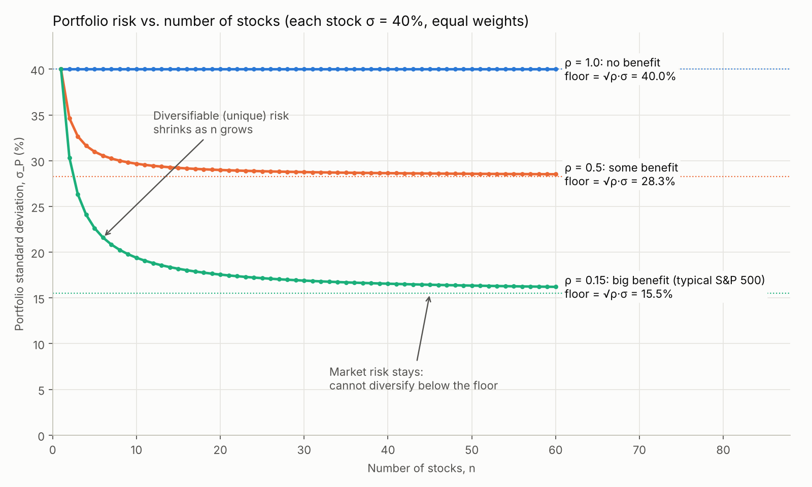
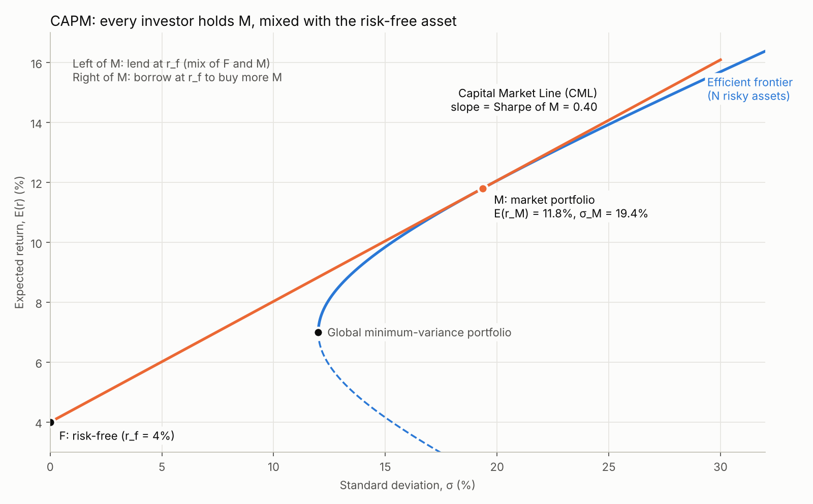
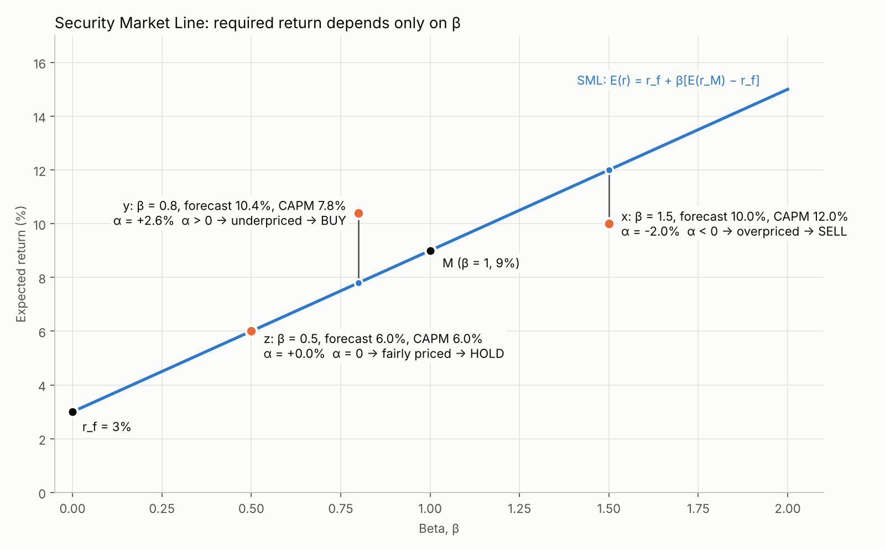

# FINA 3080 — Week 5 Notes
## Lecture 5: The Capital Asset Pricing Model (CAPM) and multifactor models

*Investment Analysis and Portfolio Management · Instructor: Chao Ying (CUHK)*

> **How to read these notes:** everything in the main text comes from the slides. Parts marked **▶ Beyond the slides** are my own explanations and worked examples. They follow the optional textbook (BKM Ch. 7–9) but were not explicitly presented in lecture. Charts are in `../charts/`.

**Today's outline**
1. Diversification
2. Markowitz selection with N risky assets
3. The CAPM
4. Multifactor models

---

## 0. Recap and announcements (slides 2–9)

### Recap: the portfolio-choice recipe (slide 4)
1. Start simple: **one risky and one risk-free asset**.
2. Combine many risky securities into a portfolio.
   - a. Two risky securities give the optimal risky portfolio **P\*** (Lecture 4).
   - b. Three, four or more: the benefits of diversification (today).
3. Combine the risky portfolio with the risk-free asset: **draw the CAL tangent to the feasible risky portfolios**.
4. Choose your own portfolio given your risk aversion: treat P\* as **one risky asset** and go back to step 1 to get **C\***.

### Finishing the Lecture 4 example (slides 5–8)
P\*: 40% bonds and 60% stocks, E(r_P\*) = 11%, σ_P\*² = 2.0164%, r_f = 5%, A = 4.
- y\* = (0.11 − 0.05) / (4 × 0.020164) = **74.39%**
- Complete portfolio: **25.61%** risk-free, **29.76%** bonds (40% × 74.39%), **44.63%** stocks (60% × 74.39%)
- **Highest utility (slide 8):**
  U_C = 0.05 + 0.7439 × (0.11 − 0.05) − ½ × 4 × 0.7439² × 0.020164 = 0.05 + 0.04463 − 0.02232 = **0.0723 (7.23%)**

### Announcements (slide 9)
- **Midterm: 7–9 pm, Oct 20, LSK LT6.** There is no class on Oct 20.
- **Coverage: Lectures 1 to 5.**
- The sample exam, its solution and the formula sheet are on Blackboard.
- **Closed book.** Bring a financial calculator.
- If you reported an exam conflict, you'll hear back separately.

---

## 1. Diversification (slides 11–14)

### How far can diversification go? (slide 11)
- Combining risky securities lowers portfolio σ **as long as they are not perfectly correlated**.
- Adding more securities strengthens this: the **efficient frontier shifts left**.

### Portfolio risk and the number of stocks (slide 12)
Assume all n stocks are **equally weighted** and have the **same variance σ²** and the **same correlation ρ** with each other. Then:

$$\sigma_P^2 = \frac{1}{n}\sigma^2 + \frac{n-1}{n}\rho\sigma^2$$

As n → ∞, the first term vanishes and (n − 1)/n → 1:

$$\lim_{n\to\infty}\sigma_P^2 = \rho\sigma^2 = \text{average covariance}$$

**Key insight:** in a well-diversified portfolio, a stock's contribution to risk depends only on its **covariance** with the other stocks, **not its own variance**.

> **▶ Beyond the slides — where the formula comes from.** With equal weights 1/n, the portfolio variance has n variance terms and n(n − 1) covariance terms:
> σ_P² = n × (1/n)²σ² + n(n − 1) × (1/n)² × ρσ² = (1/n)σ² + [(n − 1)/n]ρσ²
> The variance terms get weight 1/n² each and there are only n of them, so they vanish. The covariance terms are almost all of the n² pairs, so they survive.

### The picture (slide 13)

| ρ | Diversification potential | Floor σ_P = √ρ·σ (σ = 40%) |
|---|---|---|
| 1.0 | **None**: σ_P stays at 40% | 40.0% |
| 0.5 | Some | 28.3% |
| 0.15 (typical of S&P 500 stocks) | **High** | 15.5% |

> **▶ Beyond the slides — numbers for ρ = 0.15, σ = 40%.** n = 1: 40%. n = 10: √(0.016 + 0.9 × 0.024) = **19.4%**. n = 30: **16.9%**. n → ∞: **15.5%**. Most of the benefit comes from the first 20–30 stocks.

### Two sources of risk (slide 14)
**Total risk = market risk + unique risk**

| | **Market risk** | **Unique risk** |
|---|---|---|
| Affects | All stocks (macro) | One stock (micro) |
| Other names | General, systematic, nondiversifiable | Firm-specific, idiosyncratic, nonsystematic, diversifiable |
| Removed by diversifying? | **No**: it is the floor in the chart | **Yes**: it shrinks as n grows |
| Examples (beyond the slides) | Interest rates, recessions, oil shocks, a Fed hike | A CEO resigning, a product recall, a lawsuit |

> **▶ Beyond the slides — why this matters for pricing.** Unique risk can be removed for free by diversifying, so the market does **not** pay you for bearing it. Only market risk earns a risk premium. That's the core idea of the CAPM below.

---

## 2. Markowitz selection with N risky assets (slides 16–19)

### From two to three or more assets (slides 16–17)
- With **two** assets (Lecture 4), the opportunity set is a **curve** from D to E.
- With **three** assets (slide 17), each set of weights is one point. Varying the weights fills a **whole region**, not just a line. Its left edge is a bullet-shaped curve.

### N risky assets (slide 18)
- The **left boundary** of the region is the **minimum-variance frontier**. For each return, it gives the lowest possible risk.
- Its leftmost point is the **global minimum-variance portfolio**.
- The part **above** the global minimum-variance portfolio is the **efficient frontier**.
- Individual assets (D, E, X, Y, Z) and inefficient portfolios lie **inside**, to the right of the frontier.

### Allocation with a risk-free asset (slide 19)
The same three steps as with two assets:
1. **Draw the efficient frontier.**
2. **Pick P\*** by drawing the CAL from F tangent to the frontier. P\* is the **universal optimal risky portfolio**: the same for everyone.
3. **Pick C\*** on the CAL using the investor's indifference curves (their A).

---

## 3. The CAPM (slides 21–32)

### Assumptions (slide 21)
1. Everyone can **borrow or lend any amount at r_f**.
2. Investors are **mean–variance optimizers**.
3. Investors have a **common world view (homogeneous expectations)**: they agree on expected returns, variances and covariances.

### The market portfolio (slides 22–23)
If everyone thinks alike, then everyone:
- computes the **same efficient frontier**,
- finds the **same tangency portfolio**, and so
- holds the **same optimal risky portfolio** (the same % in each security).

Add up everyone's holdings and you get the **market portfolio, M**.

**Example (slide 23):** three investors with different wealth, all holding A : B : C = 50% : 30% : 20%.

| Stock | Investor 1 | Investor 2 | Investor 3 | Market | Market weight |
|---|---|---|---|---|---|
| A (50%) | $50 | $100 | $200 | $350 | 350/700 = **50%** |
| B (30%) | $30 | $60 | $120 | $210 | **30%** |
| C (20%) | $20 | $40 | $80 | $140 | **20%** |
| Total | $100 | $200 | $400 | $700 | 100% |

Because everyone holds the same mix, the **market's weights equal everyone's weights**.

### The Capital Market Line (slide 24)
The CAL that runs from F through M is called the **Capital Market Line (CML)**.

### CAPM implications (slide 25)
- Every investor holds **M** as their P\*.
  - M includes **all traded assets**.
  - Each asset is held in proportion to its **market capitalization**.
  - **Passive (index, "lazy") investing is efficient.**
- Every investor's C\* is a **mix of M and F**. Only y\* differs between investors, based on A.

### What is a fair expected return? (slides 26–28)
Everyone holds M, so judge each security by **what it adds to M**: its return relative to M and its risk relative to M.

**Reward-to-risk of security x (slide 27):**
$$\frac{\text{x's contribution to the market risk premium}}{\text{x's contribution to market risk}} = \frac{w_x[E(r_x) - r_f]}{w_x\sigma_{Mx}} = \frac{E(r_x) - r_f}{\sigma_{Mx}}$$

For the market portfolio itself, this is the **market price of risk**:
$$\frac{E(r_M) - r_f}{\sigma_M^2}$$

**In equilibrium (slide 28)**, prices adjust until every security offers the **same** reward to risk:
$$\frac{E(r_x) - r_f}{\sigma_{Mx}} = \frac{E(r_M) - r_f}{\sigma_M^2}$$

Multiply both sides by σ_Mx:
$$E(r_x) - r_f = \frac{\sigma_{Mx}}{\sigma_M^2}[E(r_M) - r_f]$$

Define **β_x = σ_Mx / σ_M²**. This gives the **CAPM**:
$$\boxed{E(r_x) = r_f + \beta_x[E(r_M) - r_f]}$$

> **▶ Beyond the slides — why prices adjust.** Suppose stock x offers a higher reward-to-risk than M. Everyone wants more of it, so its price rises, and a higher price means a **lower** expected return. That continues until its reward-to-risk matches the market's. The reverse happens for a stock that offers too little.

### Reading β
| β | Meaning |
|---|---|
| β = 1 | Moves with the market (M itself has β = 1) |
| β > 1 | Aggressive: amplifies market moves, so it needs a **higher** return |
| 0 < β < 1 | Defensive: moves less than the market |
| β = 0 | No market risk, so it only earns r_f |
| β < 0 | Moves against the market (a hedge). Its required return is **below** r_f |

> **▶ Beyond the slides — portfolio beta.** A portfolio's beta is the weighted average of its stocks' betas: β_P = Σ w_i β_i. For example, 60% in a stock with β = 1.5 and 40% in one with β = 0.5 gives β_P = 0.9 + 0.2 = **1.1**.

### The Security Market Line (slide 29)
Plot E(r) against β and the CAPM is a straight line:
- **Intercept:** r_f (β = 0)
- **Slope:** the market risk premium, E(r_M) − r_f
- It passes through **M at β = 1**.

### Using the SML to pick securities (slide 30)
If your forecast of a stock's return, A(r), differs from what the CAPM requires, the difference is **alpha**:
$$\alpha = A(r) - E(r) = A(r) - \{r_f + \beta[E(r_M) - r_f]\}$$

| α | Position relative to the SML | Meaning | Action |
|---|---|---|---|
| **α > 0** (stock y) | Above | Return too high, so price too **low** | **Buy** |
| **α < 0** (stock x) | Below | Return too low, so price too **high** | **Sell** |
| **α = 0** (stock z) | On the line | Fairly priced | **Hold** |

> **▶ Beyond the slides — worked example** (the chart's numbers). r_f = 3%, E(r_M) = 9%, so the market risk premium is 6%.
> - y: β = 0.8, so the CAPM requires 3% + 0.8 × 6% = 7.8%. You forecast 10.4%, so α = **+2.6%** → buy.
> - x: β = 1.5, so it requires 3% + 1.5 × 6% = 12%. You forecast 10%, so α = **−2%** → sell.
> - z: β = 0.5, so it requires 6%. You forecast 6%, so α = 0 → hold.

### Does it work? 30 Dow stocks (slide 31)
The slide plots each Dow stock's **average excess return against its beta**. The CAPM predicts the points should lie on an upward-sloping line. In the data, the relationship is **weak and noisy**: high-beta stocks don't reliably earn more. This motivates the multifactor models in section 4.

### Two ways to estimate beta (slide 32)
**1. From the covariance:**
$$\beta_i = \sigma_{iM} / \sigma_M^2$$
where σ_iM and σ_M² are calculated from sample returns. In Excel: `=COVARIANCE.S(stock, market) / VAR.S(market)`.

**2. By regression** of excess returns:
$$R_{it} = \alpha_i + \beta_i R_{Mt} + e_{it}$$
where R_it = r_it − r_f and R_Mt = r_Mt − r_f. The **intercept** is α, the **slope** is β and the **residuals** are e. In Excel: `=SLOPE(stock excess, market excess)` and `=INTERCEPT(...)`.

> **▶ Beyond the slides — numeric example.** σ_iM = 0.024 and σ_M = 20% (σ_M² = 0.04), so β = 0.024 / 0.04 = **0.6**. Equivalently, β = ρ_iM × σ_i / σ_M. With ρ = 0.4 and σ_i = 30%: β = 0.4 × 0.30 / 0.20 = 0.6.

---

## 4. Multifactor models (slides 34–37)

### The CAPM as a single-factor model (slide 34)
$$(r_i - r_f) = \alpha_i + \beta_i(r_M - r_f) + e_i$$

| Term | Meaning |
|---|---|
| Left side | The stock's **excess return** |
| α_i | The stock's expected excess return when the market's excess return is **zero** |
| β_i(r_M − r_f) | The part of the return due to **market movements** (market risk) |
| e_i | The **firm-specific** part, not due to market movements. Corr(r_M, e_i) = 0. This is unique risk. |

> **▶ Beyond the slides — splitting total risk.** Since e_i is uncorrelated with the market:
> σ_i² = β_i²σ_M² + σ²(e_i), i.e. total risk = **market (systematic) risk** + **unique (firm-specific) risk**. This is the same split as in section 1.

### Multifactor models (slide 35)
The CAPM doesn't fit the data well (slide 31), so we add more factors:
$$r_{it} - r_f = \alpha_i + \beta_{i1}(r_{1t} - r_f) + \dots + \beta_{in}(r_{nt} - r_f) + e_{it}$$
- r_1t − r_f, …, r_nt − r_f are the excess returns on the **factors**.
- β_i1, …, β_in are the stock's **factor betas** (sensitivities to each factor).
- e_it is the unanticipated firm-specific part.
- **α_i = 0 in equilibrium** (no mispricing).

### Fama–French (1993) three-factor model (slide 36)
| Factor | Definition | Captures |
|---|---|---|
| **Market** | Excess return on the market index | Market risk, as in the CAPM |
| **SMB** (small minus big) | Return on small-cap stocks − return on big-cap stocks | The **size** effect: small firms have historically earned more |
| **HML** (high minus low) | Return on high book-to-market stocks − return on low book-to-market stocks | The **value** effect: "cheap" value stocks have historically earned more than growth stocks |

$$r_i - r_f = \alpha_i + \beta_{i,M}(r_M - r_f) + \beta_{i,SMB} \text{SMB} + \beta_{i,HML} \text{HML} + e_i$$

### Passive investment strategies (slide 37)
Do what the theory says:
- **CAL:** hold a sensible mix of risk-free assets and **index funds**.
- **Don't** trade every day or try to "time the market".

Why?
- Few people **consistently** beat the market.
- Stock picking and market timing are **costly** (fees, trading costs, taxes, time).
- **Passive investing beats active investing** on average.

---

## 5. CML vs. SML

> **▶ Beyond the slides — the two lines are easy to mix up.**
>
> | | **CML** | **SML** |
> |---|---|---|
> | Horizontal axis | Total risk, **σ** | Market risk, **β** |
> | Equation | E(r_C) = r_f + [(E(r_M) − r_f) / σ_M] σ_C | E(r_i) = r_f + β_i[E(r_M) − r_f] |
> | Slope | Sharpe ratio of M | Market risk premium |
> | Which assets lie on it | Only **efficient portfolios** (mixes of F and M) | **Every** asset and portfolio, if the CAPM holds |
> | Used for | Choosing your complete portfolio | Pricing a single security and finding α |
>
> A single stock lies **below** the CML (it carries unique risk that the market doesn't reward) but **on** the SML (its β determines its fair return).

---

## 6. Formula sheet

| Concept | Formula |
|---|---|
| Equal-weighted portfolio variance | σ_P² = (1/n)σ² + [(n − 1)/n]ρσ² |
| Limit as n → ∞ | σ_P² → ρσ² (average covariance) |
| Beta | β_i = σ_iM / σ_M² = ρ_iM σ_i / σ_M |
| CAPM / SML | E(r_i) = r_f + β_i[E(r_M) − r_f] |
| Alpha | α = forecast return − CAPM return |
| CML | E(r_C) = r_f + [(E(r_M) − r_f) / σ_M] σ_C |
| Single-index regression | R_it = α_i + β_i R_Mt + e_it |
| Risk decomposition | σ_i² = β_i²σ_M² + σ²(e_i) |
| Portfolio beta | β_P = Σ w_i β_i |
| Fama–French 3-factor | r_i − r_f = α + β_M(r_M − r_f) + β_SMB·SMB + β_HML·HML + e |

---

## 7. Self-test

1. Each stock has σ = 30% and every pair has ρ = 0.2. What is σ_P for an equal-weighted portfolio of 10 stocks? What is the lowest σ_P you can reach?
2. Which type of risk does diversification remove? Which type earns a risk premium, and why?
3. Under the CAPM, why does everyone hold the market portfolio?
4. r_f = 4%, E(r_M) = 10%. Find the CAPM expected return for β = 0, 0.5, 1 and 1.8.
5. In Q4, an analyst forecasts 13% for a stock with β = 1.5. Find α. Buy or sell?
6. σ_iM = 0.018 and σ_M = 15%. Find β.
7. You hold 30% in a stock with β = 1.2, 50% in one with β = 0.8 and 20% in T-bills. What is the portfolio's β and its CAPM expected return (using Q4)?
8. Why can a single stock lie on the SML but below the CML?
9. What do SMB and HML stand for, and what do they capture?

Answers

1. σ_P² = (1/10)(0.09) + (9/10)(0.2)(0.09) = 0.009 + 0.0162 = 0.0252, so σ_P = **15.9%**. The floor is √(0.2) × 30% = **13.4%**.
2. Diversification removes **unique (firm-specific) risk**. Only **market (systematic) risk** earns a premium, because unique risk can be removed for free, so the market doesn't pay you to bear it.
3. Everyone has the same expectations, so everyone computes the same efficient frontier and the same tangency portfolio. When all investors hold the same risky portfolio, it must be the market portfolio.
4. Market risk premium = 6%. β = 0: **4%**. β = 0.5: **7%**. β = 1: **10%**. β = 1.8: **14.8%**.
5. CAPM return = 4% + 1.5 × 6% = 13%. α = 13% − 13% = **0** → fairly priced: hold.
6. β = 0.018 / 0.0225 = **0.8**.
7. β_P = 0.3(1.2) + 0.5(0.8) + 0.2(0) = 0.36 + 0.40 = **0.76**. E(r) = 4% + 0.76 × 6% = **8.56%**.
8. The SML prices **market risk** (β) only, so any fairly priced asset lies on it. The CML uses **total risk** (σ). A single stock also carries unique risk, which adds to σ without adding to the expected return, so it sits below the CML.
9. **SMB = small minus big** (the size effect: small-cap minus large-cap returns). **HML = high minus low** book-to-market (the value effect: value minus growth stocks).

